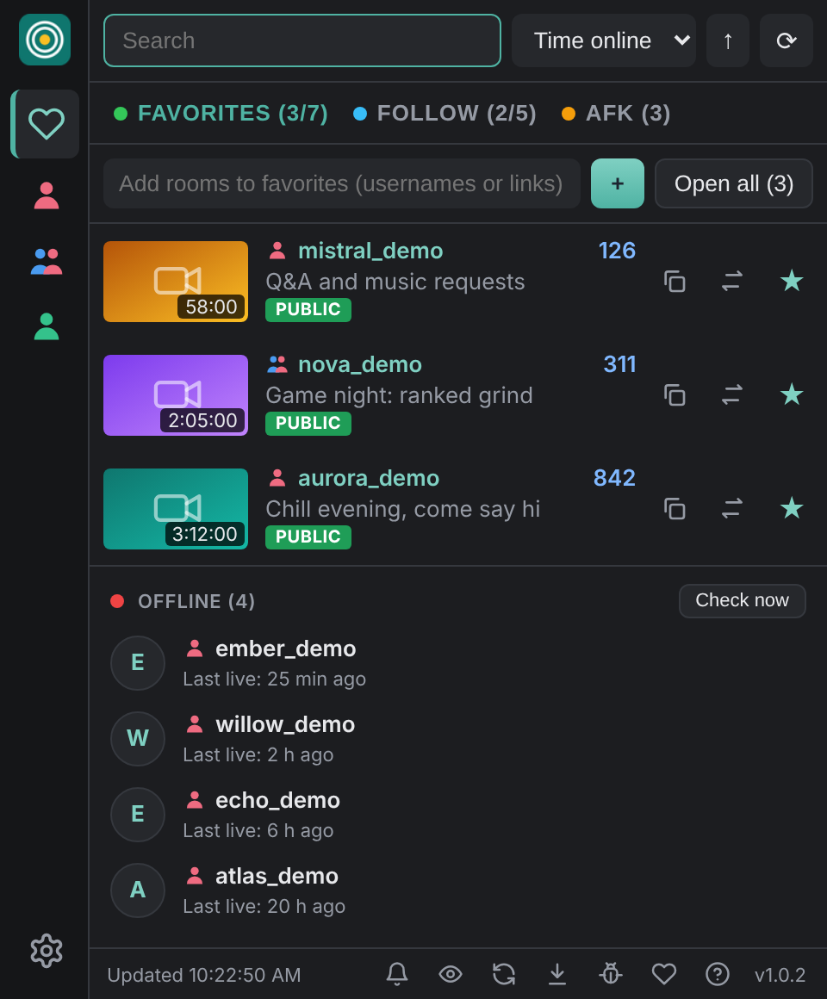
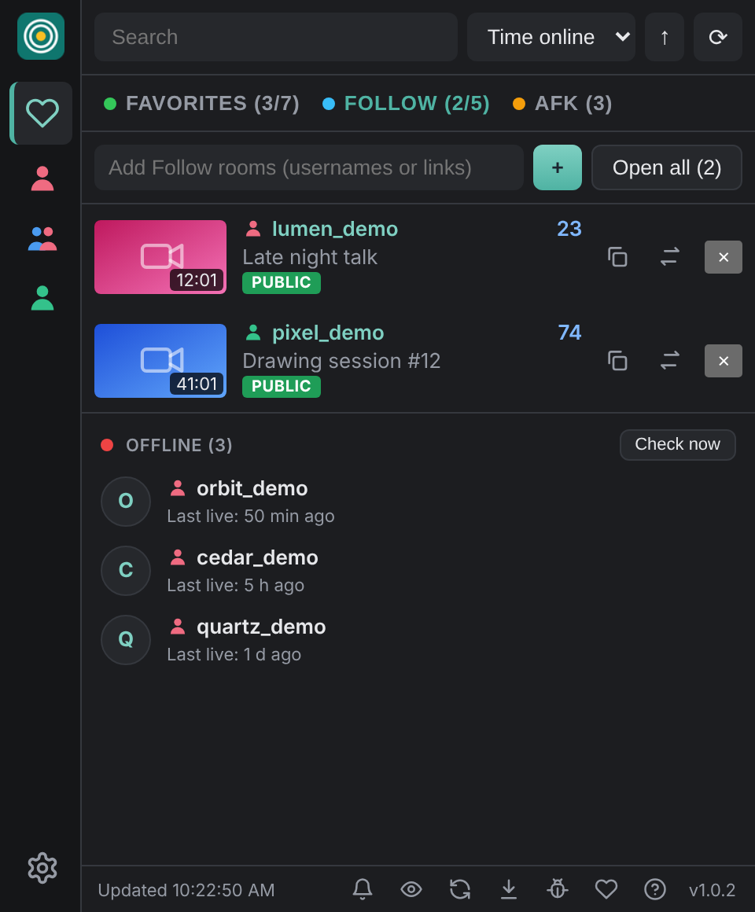
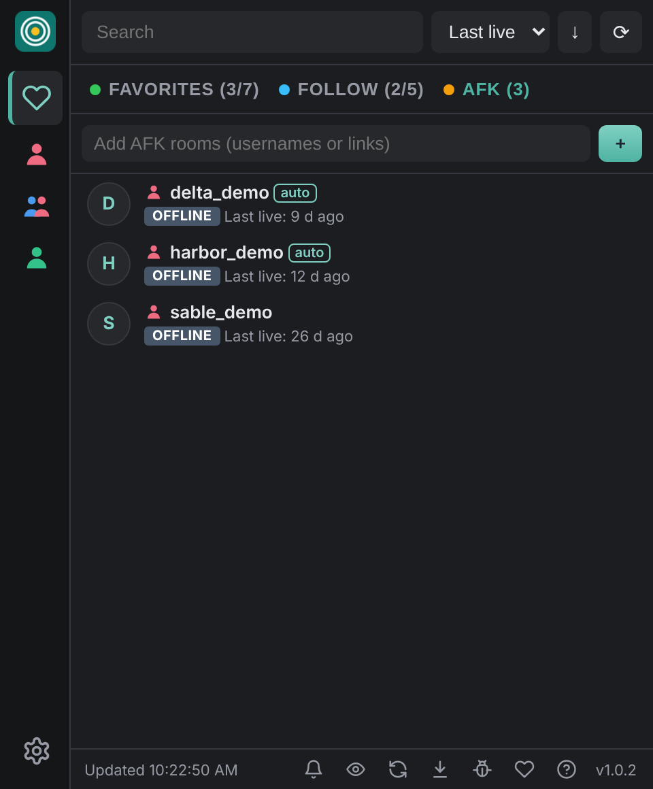
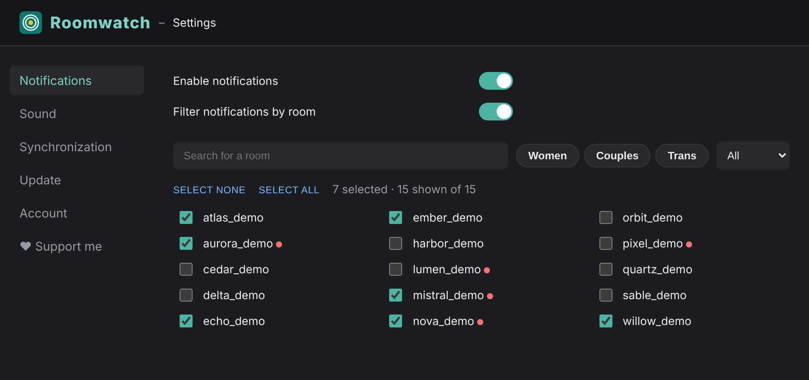

# Roomwatch

Live notifications and tidy lists for the cam rooms you follow. Roomwatch lives in your browser toolbar and tells you when your **favorite** rooms go live, so you can follow hundreds of rooms but only get pinged for the ones that matter.

  

## Screenshots

  
  
  

  

*Demo data: all names and thumbnails are fictional.*

## Features

- **Favorites**: pick your best rooms and get a notification (and a sound) when they go live. Live rooms first, then offline rooms with their last broadcast time.
- **Follow**: the same view for the rest of your follows, without notifications.
- **AFK**: rooms that have been offline for a while move here automatically and come back on their own when they return.
- Live duration, viewer count and scrolling titles.
- Pause notifications (1 h, 2 h, until tomorrow), discreet mode (blur + mute, `Alt+Shift+H`).
- Keyboard shortcuts: `Alt+Shift+F` opens the window, `Alt+Shift+O` opens your live favorites.
- Themes, custom sounds, 4 languages (English, French, Russian, German).
- Optional sync of your lists between your computers through your own WebDAV server (NAS, Nextcloud...).
- Built-in help: the **?** button explains every button.

## Install

Roomwatch is not on the Chrome Web Store. Install it by hand (works on Chrome, Edge, Brave and other Chromium browsers):

1. Download `roomwatch-vX.Y.Z.zip` from the [latest release](../../releases/latest).
2. Unzip it into a folder you will **keep** (for example `Documents/Roomwatch`).
3. Open `chrome://extensions` (or `edge://extensions`, `brave://extensions`) and turn on **Developer mode**.
4. Click **Load unpacked** and select the unzipped `roomwatch` folder.
5. Pin the extension and log in to Chaturbate in the same browser.

## Updates

Roomwatch checks for new versions on its own and shows a notification. To install one: click the download arrow in the popup, then **Update now** in the settings page, and pick the Roomwatch folder once when asked. You can also download the new zip from Releases and replace the files by hand.

## Privacy

- Your lists and settings stay in your browser.
- Roomwatch only talks to Chaturbate (to read the rooms you follow, using the session already open in your browser) and to GitHub (to look for updates).
- It never sees or stores your password.
- Sync is optional and goes only to a server you choose.
- No analytics, no tracking.

## Support the project

Roomwatch is free. If it is useful to you, you can leave a tip with the heart button in the app: https://tipeee.com/freyrstudio/

## Bugs and ideas

Use the bug button in the popup (it opens a pre-filled GitHub issue) or open an [issue](../../issues).

Roomwatch is an independent project and is not affiliated with Chaturbate.
